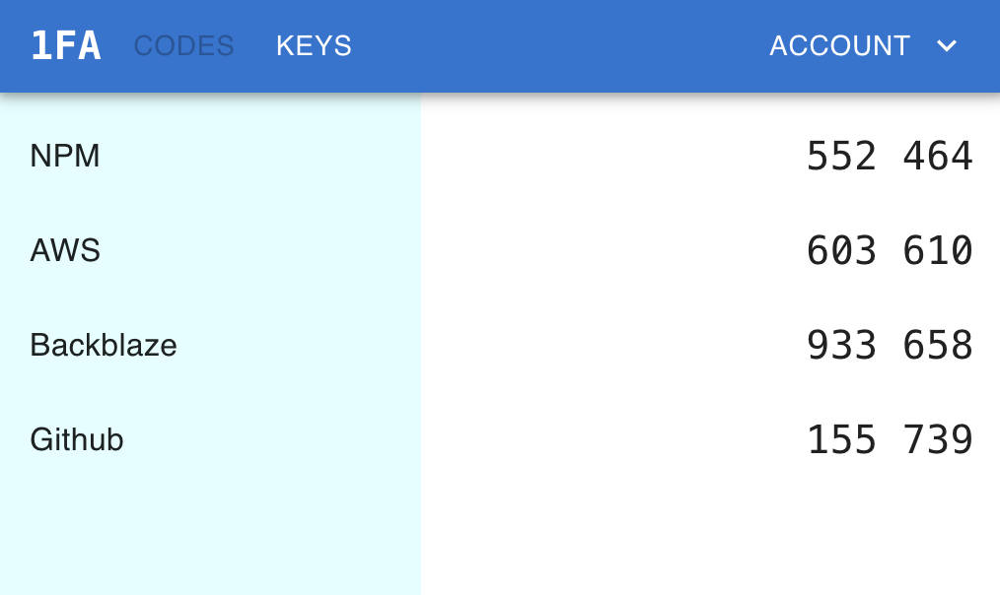

# Onefa

Onefa - fight back against forced MFA!

Authentication for online accounts is a tradeoff between security and convenience. The tradeoff for your accounts should be your decision - you might choose multi-factor
authentication for some accounts and simple password authentication for others.

Unfortunately more and more online services are forcing the use of multi-factor
authentication without any regard for user choice.

Onefa is an online authenticator app that you can access from any browser, without needing additional devices.

## Operating Onefa

Onefa depends on:
- A Keycloak authentication server
- A Postgres database

Pass the following environment variables to the Onefa Docker container:
- `DATABASE_URL`: connection string to the Postgres database
- `AUTH_SERVER_URL`: public URL of the Keycloak server
- `APP_URL`: public URL of Onefa's deployment

If running uncontainerized, pass the following additional environment variables:
- `STATIC_FILE_ROOT`: path to frontend bundles
